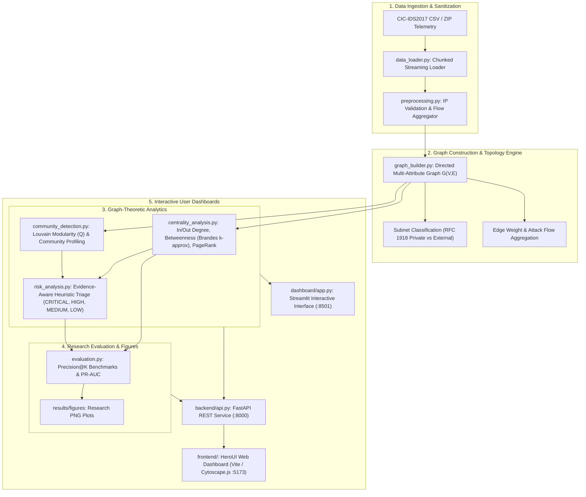
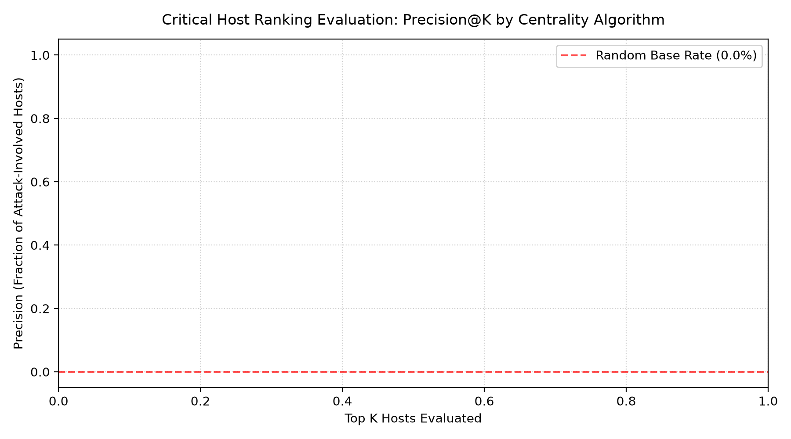
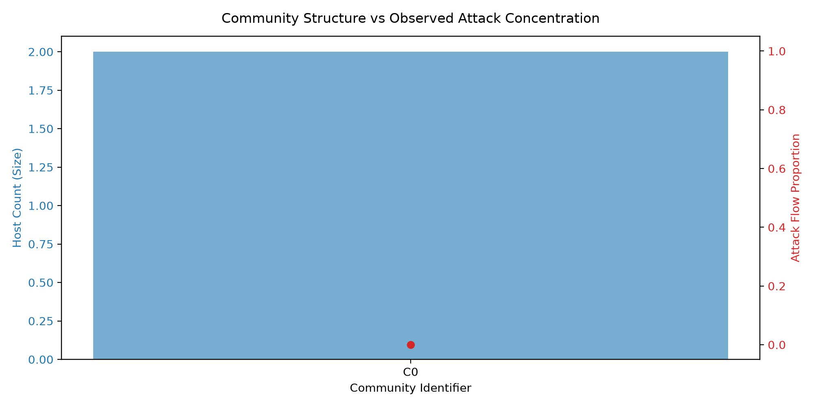

# Detection of Critical Hosts and Malicious Communities in Cyber Attack Networks Using Social Network Analysis (SNA)

[](https://www.python.org/downloads/)
[](https://fastapi.tiangolo.com)
[](https://networkx.org/)
[](https://vitejs.dev/)
[](https://heroui.com/)
[](LICENSE)

An explainable, graph-theoretic cybersecurity analytics and forensic triage platform. The system models enterprise host-to-host network communications from CIC-IDS2017 flow telemetry as directed, weighted graphs, calculates multi-dimensional topological centrality, detects communication clusters using Louvain modularity optimization, and isolates malicious activity without relying on opaque black-box classifiers.

---

## 1. Project Overview

Modern Security Operations Centers (SOCs) face telemetry overload: millions of daily NetFlow/IPFIX records are typically ingested as independent tabular events or classified using black-box machine learning models that offer minimal contextual explainability. 

This project demonstrates how **Social Network Analysis (SNA)** transforms flat packet capture flows into an actionable, topological graph model ($G = (V, E)$). By analyzing structural connectivity patterns, communication bridges, and community densities alongside empirical attack flow ground truth, the framework provides human-interpretable investigation rationales for security analysts.

---

## 2. Main Objectives

1. **Identify Structurally Important Hosts:** Quantify direct connectivity, communication bottlenecks, and topological prestige using Degree Centrality, Betweenness Centrality, and PageRank to locate key servers, routers, and infrastructure assets.
2. **Detect Network Communities using Louvain:** Partition the network topology into dense communication clusters using unsupervised Louvain modularity optimization ($Q$) to detect functional subnets and lateral movement boundaries.
3. **Examine Attack-Associated Traffic:** Cross-reference topological structures with observed attack-labeled flows to detect malicious activity hubs, scanning campaigns, and distributed denial-of-service (DDoS) reflection targets.
4. **Compare Host-Ranking Approaches:** Benchmark pure unsupervised topological metrics against observational ground truth using rank-based **Precision@K** and PR-AUC metrics.
5. **Provide Explainable Results through an Interactive Dashboard:** Deliver forensic summaries, interactive node-link network exploration (Plotly/Cytoscape), and transparent decision rules via a modern HeroUI web application and an accompanying Streamlit interface.

---

## 3. Technology Stack

- **Core Analysis & Graph Algorithms:** Python 3.11+, NetworkX 3.6+, Scipy, NumPy, Pandas, Scikit-learn
- **Backend API & Web Server:** FastAPI, Uvicorn, Pydantic v2, HTTPX, Starlette
- **Modern Web Dashboard:** HTML5, CSS3, Vanilla JavaScript (ES modules), HeroUI v3 styling (`@heroui/styles`), Cytoscape.js, Plotly.js, Vite
- **Alternative / Legacy Dashboard:** Streamlit, Plotly Express
- **Automated Testing:** Pytest, AnyIO
- **Version Control & Repository Management:** Git, GitHub, GitHub CLI (`gh`)

---

## 4. System Architecture & Data Flow



---

## 5. Input Data Requirements & Graph Construction

### Required Input Columns (CIC-IDS2017)
The system processes flow-level telemetry files (such as `Friday-WorkingHours-Afternoon-DDos.pcap_ISCX.csv`). The CSV input must include:

| Column Name | Type | Description |
| :--- | :--- | :--- |
| `Source IP` | String (IPv4) | Initiating sender host IP address |
| `Destination IP` | String (IPv4) | Target recipient host IP address |
| `Timestamp` | String (DateTime) | Flow capture timestamp (e.g., `dd/MM/yyyy HH:mm:ss`) |
| `Protocol` | Integer | Transport protocol (6 = TCP, 17 = UDP, 1 = ICMP) |
| `Label` | String | Ground-truth flow label (`BENIGN`, `DDoS`, `PortScan`, etc.) |

### Academic Definitions:
- **Node ($v \in V$):** Unique IPv4 address classified as **Internal** (`10.0.0.0/8`, `172.16.0.0/12`, `192.168.0.0/16`) or **External**.
- **Directed Edge ($(u, v) \in E$):** Observed communication flow from source host $u$ to destination host $v$.
- **Edge Weight ($w_{uv}$):** Total flow count observed between host pair $(u, v)$ with preserved metadata (attack flow count, protocols, timestamps).
- **Combined Criticality Score:** Weighted linear combination of min-max normalized centralities:
  $$\text{Criticality}(v) = w_{\text{deg}} \cdot C_{\text{deg}}(v) + w_{\text{bet}} \cdot C_{\text{bet}}(v) + w_{\text{pr}} \cdot PR(v)$$
  *(Default weights: $w_{\text{deg}}=0.40, w_{\text{bet}}=0.35, w_{\text{pr}}=0.25$)*.

---

## 6. Dataset Instructions

The system is designed for the benchmark **CIC-IDS2017** dataset published by the Canadian Institute for Cybersecurity (UNB):
- **Official Dataset Link:** [UNB CIC-IDS2017 Dataset](https://www.unb.ca/cic/datasets/ids-2017.html)

### Important Dataset Notes:
1. **Required Variant:** Download the **`GeneratedLabelledFlows.zip`** (TrafficLabelling) package containing IP addresses. The anonymized `MachineLearningCVE` variant omits IP addresses and cannot be used for graph topological analysis.
2. **Local Placement:** Extract the downloaded CSV files into:
   ```
   Datasets/TrafficLabelling/
   ```
   or into:
   ```
   data/raw/
   ```
3. **Dataset Git Exclusion:** In compliance with repository best practices, **raw dataset archives and large CSV files are excluded from Git version control via `.gitignore`**.

---

## 7. Project Structure

```
sna-cyber-attack-network-analysis/
├── backend/
│   ├── __init__.py
│   ├── api.py                    # FastAPI REST application & static file mounter
│   ├── pipeline_service.py       # Thread-safe pipeline execution & cache manager
│   └── schemas.py                # Pydantic v2 response & request schemas
├── dashboard/
│   ├── __init__.py
│   ├── app.py                    # 7-page interactive Streamlit dashboard
│   └── components/
│       ├── metrics_cards.py      # Streamlit custom cybersecurity metric cards
│       └── network_graph.py      # Plotly interactive network graph component
├── data/
│   ├── raw/                      # Raw dataset input directory (.gitkeep)
│   └── processed/                # Preprocessed output directory (.gitkeep)
├── Datasets/                     # Local directory for CIC-IDS2017 CSVs (ignored by Git)
├── frontend/
│   ├── index.html                # Single-page application entry point
│   ├── package.json              # Frontend npm dependencies & scripts
│   ├── package-lock.json         # Locked npm dependencies
│   ├── vite.config.js            # Vite bundler & reverse proxy configuration
│   └── src/
│       ├── main.js               # Application router & theme controller
│       ├── api.js                # REST client for FastAPI endpoints
│       ├── state.js              # Reactive state store
│       ├── components/           # UI components (Header, Sidebar, Metrics, Graph, Tables)
│       ├── pages/                # Views (Overview, Explorer, Critical Hosts, Communities, etc.)
│       └── styles/               # HeroUI-inspired cybersecurity design tokens & CSS
├── results/
│   ├── .gitkeep                  # Preserves results directory
│   └── figures/                  # Academic research figures
│       ├── community_attack_enrichment.png
│       └── precision_at_k_comparison.png
├── src/
│   ├── __init__.py
│   ├── data_loader.py            # Chunked CSV & ZIP streaming loader
│   ├── preprocessing.py          # IP subnet validation & flow aggregator
│   ├── graph_builder.py          # NetworkX directed graph builder
│   ├── centrality_analysis.py    # Degree, Brandes Betweenness, PageRank
│   ├── community_detection.py    # Louvain modularity & partition analysis
│   ├── risk_analysis.py          # Evidence-aware heuristic triage
│   └── evaluation.py             # Precision@K, PR-AUC, and benchmark plotting
├── tests/
│   ├── __init__.py
│   ├── test_api.py               # Backend endpoint integration tests
│   ├── test_centrality.py        # Centrality calculation tests
│   ├── test_community.py         # Louvain community detection tests
│   ├── test_dashboard.py         # Dashboard components tests
│   ├── test_evaluation.py        # Precision@K evaluation tests
│   ├── test_graph_builder.py     # Graph construction & IP parsing tests
│   ├── test_preprocessing.py     # Data cleaning & flow aggregation tests
│   └── test_risk_analysis.py     # Priority tiering & triage logic tests
├── .gitignore                    # Comprehensive ignore rules (data, cache, dist, venv)
├── DASHBOARD_GUIDE.md            # Detailed presentation and operator manual
├── METHODOLOGY.md                # In-depth algorithmic & mathematical specification
├── requirements.txt              # Locked Python dependencies
└── README.md                     # Project documentation
```

---

## 8. Installation & Execution

### Prerequisites
- **Python:** 3.11 or higher
- **Node.js:** v18+ (tested on Node.js v22+ and npm 10+)
- **OS:** Windows 10/11, Linux, or macOS

### Step 1: Clone Repository & Set Up Python Environment
```powershell
# Open terminal in project directory
cd sna-cyber-attack-network-analysis

# Create virtual environment
python -m venv .venv

# Activate on Windows PowerShell:
.\.venv\Scripts\Activate.ps1
# On Linux/macOS:
# source .venv/bin/activate

# Install required Python packages
pip install -r requirements.txt
```

### Step 2: Install Frontend Dependencies
```powershell
cd frontend
npm install
cd ..
```

### Step 3: Launch the Platform

#### Mode A: HeroUI Web Dashboard (Recommended for Live Demo)
Run the backend and frontend in separate terminals:

**Terminal 1 — FastAPI Backend:**
```powershell
.\.venv\Scripts\Activate.ps1
python -m uvicorn backend.api:app --reload --host 127.0.0.1 --port 8000
```
*API Swagger Documentation:* `http://127.0.0.1:8000/docs`

**Terminal 2 — HeroUI Frontend (Vite Dev Server):**
```powershell
cd frontend
npm run dev
```
*Web Application:* `http://localhost:5173`

#### Mode B: Unified Single-Server Mode
Build frontend static assets and serve directly from FastAPI:
```powershell
cd frontend
npm run build
cd ..
python -m uvicorn backend.api:app --host 127.0.0.1 --port 8000
```
*Open:* `http://127.0.0.1:8000`

#### Mode C: Legacy Streamlit Dashboard
```powershell
.\.venv\Scripts\Activate.ps1
python -m streamlit run dashboard/app.py
```
*Open:* `http://localhost:8501`

---

## 9. Running Automated Tests

The test suite includes **36 unit and integration tests** validating graph construction, centrality measures, community detection, risk triage logic, figure generation, and all FastAPI endpoints:

```powershell
.\.venv\Scripts\pytest tests/ -v
```

All 36 tests execute in approximately 15–20 seconds.

---

## 10. Research Evaluation & Findings

### Figure 1: Precision@K Benchmark Comparison
Evaluation comparing pure unsupervised SNA topological metrics against observational attack labels:



### Figure 2: Community Attack Concentration
Visualization of Louvain community partitioning and concentration of attack-associated flows:



---

## 11. Key Limitations & Academic Disclosures

1. **Observational Proxy Labels vs Ground Truth:** In NetFlow logs, a host is marked as attack-involved if it transmits or receives an attack-labeled flow. In real enterprise environments, a host appearing in attack traffic may be an attacker, an exploited intermediary, or an innocent enterprise server targeted by an external denial-of-service attack.
2. **Centrality is Structural, Not Moral:** High centrality signifies structural importance (e.g., domain controllers, default gateways, and DNS resolvers naturally exhibit high degree and betweenness). Topological centrality alone does not imply compromise; our heuristic triage strictly couples centrality with direct forensic evidence to prevent false positives.
3. **Approximation in Large Graphs:** Brandes betweenness centrality has worst-case time complexity $O(V \cdot E)$. For networks exceeding 500 hosts, the engine automatically activates randomized $k$-node sampling ($k = 0.2N$) to guarantee bounded sub-second latency while preserving ranking fidelity.

---

## 12. Future Improvements

- **Streaming Graph Analytics:** Integrate graph streaming algorithms (e.g., incremental PageRank and dynamic Louvain) via WebSocket feeds to analyze packet captures in real-time.
- **Graph Neural Networks (GNNs):** Complement unsupervised SNA metrics with inductive node classification (e.g., Graph Convolutional Networks or GraphSAGE) for anomaly scoring.
- **MITRE ATT&CK Mapping:** Map detected communication patterns (such as fan-out port scanning or internal lateral movement) directly to ATT&CK Enterprise Techniques.
- **Multi-Day Temporal Graph Evolution:** Track how host centrality shifts before, during, and after an incident across consecutive days of network captures.

---

## License

This project is developed for academic research and educational purposes under the MIT License.
